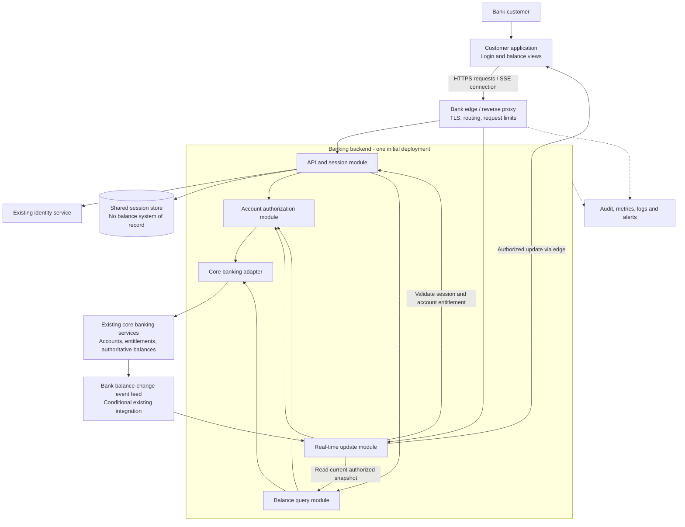

# Proposed High-Level Architecture: Banking Login and Balance Viewing

## 1. Purpose, scope, and status

This architecture is based on [requirements.md](./requirements.md). It supports username/password login, authenticated viewing of savings and checking balances, and real-time balance updates.

The solution is read-only with respect to banking accounts. Registration, password recovery, transfers, payments, transaction history, and account lifecycle management remain outside scope.

**Status:** Proposed, technology-neutral architecture for stakeholder review. Controls associated with derived or proposed requirements are recommendations, not newly approved requirements. Balance semantics, real-time thresholds, service-level targets, platform coverage, and bank policies remain subject to the source document's open questions.

**Design review, 2026-11-03:** The requesting user agreed to the seven revisions recorded in [design-review.md](./design-review.md). They are incorporated below as the reviewed design baseline. This agreement does not constitute bank stakeholder approval, integration validation, or production readiness.

## 2. Recommended architecture

Use a **customer-facing client and a modular banking backend**, integrated with the bank's existing identity and core account services. Keep authentication/session handling, authorization, balance retrieval, and update delivery as logical modules in one backend deployment initially.

This avoids unnecessary microservices, duplicate credential storage, and a separate balance database for a small read-only feature. Modules can be deployed independently later only if measured scale or bank platform constraints justify it.

For a proposed browser client:

- Use HTTPS APIs for login, initial balance retrieval, and logout.
- Use Server-Sent Events (SSE) for one-way balance updates. Two-way WebSocket communication is not needed for this feature.
- Keep the customer session in a secure, server-managed cookie rather than exposing bank-service tokens to browser code.

The story does not mandate a browser application. Native-channel authentication and streaming adapters must be selected if mobile or other channels are approved. SSE and the event-source integration are conditional on platform and source-system capabilities.

## 3. System context and component diagram

The arrows represent logical interactions, not a required internal network topology. The update arrow back to the client uses the established edge connection; the backend is not directly public.

**Trust boundaries:** The customer device is untrusted; the public edge exposes only approved application routes; backend-to-identity and backend-to-core traffic uses authenticated bank integrations. Customer input never establishes account ownership or downstream privileges.

## 4. Key components and responsibilities

| Component                        | Responsibilities                                                                                                                                                                                                                                                                                  | Requirements supported                                                 |
| -------------------------------- | ------------------------------------------------------------------------------------------------------------------------------------------------------------------------------------------------------------------------------------------------------------------------------------------------- | ---------------------------------------------------------------------- |
| Customer application             | Provide accessible username/password inputs; show validation and invalid-login messages; display account type, approved masked label, currency, and exact balance; manage loading, no-account, unavailable, and stale states; apply ordered updates; clear sensitive view state on logout/expiry. | FR-01, FR-03 through FR-06, FR-08 through FR-12; BR-04; NFR-07, NFR-11 |
| Bank edge / reverse proxy        | Terminate approved TLS; route API and streaming traffic; apply request-size and bank-approved rate limits; protect public endpoints; support streaming timeouts without buffering updates. Do not cache personalized account responses.                                                           | NFR-02 through NFR-05, NFR-08                                          |
| API and session module           | Validate input on the server as well as the client; delegate authentication; establish and validate customer sessions; expose balance and logout operations; provide consistent error responses; enforce expiry/revocation for requests and streams.                                              | FR-02, FR-03, FR-04, FR-11, FR-12; BR-01; NFR-05                       |
| Existing identity service        | Validate credentials and apply bank authentication policy, including any approved MFA, attempt controls, and lockout rules. Own credential lifecycle and secure storage; this feature does not create another password database.                                                                  | FR-02, FR-03; NFR-04, NFR-05; OQ-05                                    |
| Account authorization module     | Resolve the authenticated principal's eligible savings/checking accounts using bank entitlements; deny unauthorized account requests; enforce the same rules for initial reads, subscriptions, and updates; respond to entitlement changes.                                                       | FR-05, FR-07; BR-02; OQ-03                                             |
| Balance query module             | Retrieve current authoritative balances for authorized accounts; preserve amount precision, currency, balance type, and source version; distinguish no accounts from dependency failure; produce the client-facing account snapshot.                                                              | FR-04, FR-05, FR-08 through FR-10; BR-03 through BR-06; NFR-06         |
| Core banking adapter             | Encapsulate existing account, entitlement, and balance contracts; authenticate service calls with least privilege; translate source formats and explicit errors; apply bounded timeouts and approved read-retry policies. Never fabricate a successful balance.                                   | FR-07, FR-09; BR-03, BR-04; NFR-04, NFR-06, NFR-10                     |
| Real-time update module          | Consume authoritative change signals; deliver only authorized account updates; coordinate snapshots and incremental updates; reject duplicate/older versions; detect gaps and source outages; resynchronize after reconnection; terminate expired/revoked subscriptions.                          | FR-06, FR-07, FR-09, FR-11; BR-06; NFR-01, NFR-06, NFR-08, NFR-10      |
| Existing core banking services   | Remain the system of record for customer/account relationships, entitlement information, and balances. Supply the agreed balance definition and freshness/version information.                                                                                                                    | FR-04 through FR-07; BR-03, BR-05, BR-06                               |
| Balance-change event feed        | Provide committed balance-change notifications with an account identifier and reliable ordering/version or replay information. Prefer an existing bank feed; a new broker is not mandatory. Availability and semantics must be confirmed.                                                         | FR-06; NFR-01, NFR-06; OQ-02                                           |
| Shared session store             | Hold protected session identity, expiry, and revocation state across backend replicas. Do not store passwords or become an authoritative balance repository.                                                                                                                                      | FR-11; NFR-03 through NFR-05                                           |
| Audit and observability platform | Collect approved authentication/access events, dependency failures, freshness lag, latency, availability, and stream health; redact secrets and unnecessary financial data; enforce approved access/retention; alert on operational failures.                                                     | NFR-01 through NFR-03, NFR-09, NFR-10; OQ-08                           |

## 5. Principal interaction flows

### 5.1 Login and initial balance display

1. The client validates that username and password are supplied, then sends them over HTTPS to the login API.
2. The API validates the request and delegates authentication to the existing identity service. Credentials are not persisted or logged by the banking backend.
3. Invalid credentials produce a generic invalid-login response and no session. Identity-service outages produce an explicit service-unavailable response, not an invalid-credentials result.
4. On success, the backend establishes a new opaque, server-managed customer session, replacing any prior session identifier. The client immediately requests account balances without another login. Client requests and subscriptions are associated with the active authentication generation; responses from an earlier generation are discarded after logout, expiry, or a different login.
5. The backend validates the session, resolves authorized eligible accounts, and reads their authoritative balances through the adapter.
6. The client displays the returned savings/checking accounts with approved labels, currencies, balance values, and freshness metadata.
7. No eligible accounts produces a successful empty collection and an explicit no-accounts view only after successful entitlement resolution. The initial response is complete for the resolved eligible account set or explicitly fails: if any required account balance cannot be retrieved, do not silently omit that account or publish a partial snapshot as complete. This completeness rule does not assert an atomic, cross-account financial snapshot.

### 5.2 Real-time balance updates

1. The client opens an authenticated SSE connection. The backend validates the session and resolves authorized account subscriptions; client-supplied account identifiers are not trusted.
2. To avoid losing a change between initial retrieval and subscription, the update module establishes bounded change capture before obtaining a synchronization snapshot, then reconciles buffered events against the snapshot's source versions. Implementation requires a source-supported consistent snapshot/cursor or a documented equivalent capture-and-read guarantee; buffering alone cannot make a lagging source read consistent. If capture overflows or continuity is uncertain, invalidate synchronization and restart it rather than delivering a potentially incomplete stream.
3. The client receives the synchronization snapshot and then newer account updates. Snapshots establish the eligible account set and its synchronization generation; reconciliation removes accounts no longer authorized and invalidates obsolete per-account state. Apply only responses from the current authentication/synchronization generation, and do not let a late initial API response overwrite a newer streamed value.
4. Each change originates from committed source data. A notification without a trustworthy balance payload triggers a current authoritative read; the backend does not calculate the balance from transaction deltas.
5. Source ordering/version information is used per account to ignore duplicates and older updates. Balance versions are not assumed to be consecutive event sequence numbers. Use a feed cursor/sequence with defined continuity, or authoritative reconciliation, to establish completeness. A detected gap, expired cursor, or source-version reset triggers a new synchronization generation and snapshot rather than pretending the stream is complete. Reconnect cursors are validated and scoped to the current authorized subscription, never used as authority to access an account.
6. The backend checks session validity and current account entitlement before dispatch. Logout and entitlement-revocation signals reach every replica hosting affected subscriptions; local dispatch cancels queued updates and checks the current validity generation before enqueue/send. Scheduled session-expiry checks run even on quiet streams. Define and approve revocation propagation bounds and the source contract for entitlement changes; event notifications alone do not guarantee instantaneous revocation. If session/entitlement validity cannot be established, stop protected reads and updates, clear affected client data, and require revalidation. Already delivered data cannot be recalled from an untrusted device.
7. Disconnection, missed health checks, an unhealthy source feed, or an exceeded approved freshness limit changes the UI to an explicit stale/unavailable state. A connection heartbeat proves transport health only, not source-data freshness. An unchanged balance can remain current: its last-change timestamp is not a freshness deadline. Establish source progress/health using a defined feed watermark or health contract, or periodic authoritative reconciliation within the approved freshness budget. Expose verification status separately from balance-change time. A failed account refresh marks that account unavailable/stale without converting it to zero; a feed-wide failure marks all affected accounts.
8. On reconnection or return to an inactive view, the backend revalidates authorization and resynchronizes with current source data before the UI marks balances current.

**Integration gate:** This flow requires adequate source consistency, versioning, and change capture. If these are unavailable, evaluate bounded polling against the approved freshness target and source capacity. Polling is acceptable only when tests demonstrate that it satisfies AC-04/NFR-01; otherwise source-system enhancement is a prerequisite, not an assumed workaround.

**Delivery and recovery contract:** Logical fan-out must deliver each account change to every backend replica with an affected active subscription. A single competing-consumer group across those replicas is insufficient without explicit routing to the other subscription owners. Use the existing bank platform's supported fan-out/routing mechanism; no new broker is implied. Bound capture and per-client buffers, reconnect with capped exponential backoff and jitter, and resynchronize after overload or replica failover. Coalesce current-balance refreshes by account where safe, while rechecking each recipient's authorization; retries, reconciliation, and revocation checks count toward the downstream capacity budget. Drain streams explicitly during deployment so clients reconnect rather than remaining silently stalled.

### 5.3 Logout and session expiry

1. Logout invalidates the shared server-side session and associated streams across replicas. The server expires the HttpOnly cookie with matching path/domain attributes; browser JavaScript cannot delete that cookie. The client immediately closes streams, clears in-memory account data, and invalidates outstanding request/subscription generations.
2. Expiry or revocation rejects protected requests and stops update delivery even without balance events. Late API/stream callbacks from invalidated generations are discarded rather than restoring cleared data. The client returns to an unauthenticated state. If logout cannot reach the server, show an explicit unconfirmed-logout result and keep the local view cleared; do not claim server-side revocation succeeded.
3. Personalized responses use `Cache-Control: no-store`. The client clears/restores protected views appropriately during back navigation and page restoration so previously rendered balances are not exposed after logout.
4. Streaming heartbeats and automatic balance updates do not count as customer activity for extending inactivity timeouts unless bank policy explicitly allows it.

## 6. Logical API and data boundaries

These operations are illustrative contracts, not a fixed API specification:

| Operation                    | Responsibility / outcome                                                                                                            |
| ---------------------------- | ----------------------------------------------------------------------------------------------------------------------------------- |
| Login                        | Accept username/password; authenticate; establish a session or return a clear authentication/service error.                         |
| Read accounts and balances   | Require authentication; return only authorized eligible accounts and their source-derived balance snapshots.                        |
| Subscribe to balance updates | Require authentication and entitlement; provide synchronization and ordered updates, plus explicit stale/resynchronization signals. |
| Logout                       | Revoke the session and terminate its update subscriptions.                                                                          |

Each account snapshot/update should carry an opaque account reference, account type, approved masked label, currency, agreed balance type, exact amount, and source version/freshness information. Define synchronization generation, eligible-set completeness, verification status/time, and any replay cursor separately from the last balance-change time. Treat replay cursors as opaque, scoped continuity metadata, not authentication. Use decimal strings or an agreed exact-decimal representation across interfaces, not binary floating-point arithmetic for monetary values.

Use explicit outcomes for missing input, invalid credentials, unauthenticated/expired sessions, unauthorized accounts, and dependency unavailability. Include safe correlation identifiers without exposing internal diagnostics, credentials, full account identifiers, or downstream tokens.

**Data ownership:** Identity services own credentials; core banking owns account and balance data; the feature owns session state and approved operational records. Client balances and any server-side stream buffers are temporary views, not systems of record. Do not persist customer balances in browser storage or introduce a balance cache by default.

## 7. Cross-cutting architecture decisions

| Concern                         | Proposed approach                                                                                                                                                                                                                                                                                                           | Approval / verification                                                                                                                                                 |
| ------------------------------- | --------------------------------------------------------------------------------------------------------------------------------------------------------------------------------------------------------------------------------------------------------------------------------------------------------------------------- | ----------------------------------------------------------------------------------------------------------------------------------------------------------------------- |
| Security                        | TLS at public and service boundaries; least-privilege service identities; managed secrets; generic invalid-login messages; shared attempt controls. Browser cookies use Secure, HttpOnly, and an approved SameSite policy; protect cookie-authenticated state-changing operations against CSRF and validate stream origins. | Bank policy review and authentication/authorization tests; NFR-04, NFR-05.                                                                                              |
| Availability                    | Run multiple backend replicas behind the bank edge across available failure domains; use a resilient shared session service. Edge, identity, core, and event-feed availability constrain the end-to-end service.                                                                                                            | Confirm topology and maintenance policy; measure NFR-03 rather than asserting an unsupported uptime percentage.                                                         |
| Scaling and performance         | Scale replicas by API demand and active stream capacity. Apply the fan-out, buffer, reconnect, and downstream capacity contract in Section 5.2; include snapshot, reconciliation, session, and entitlement traffic in sizing.                                                                                               | Test approved login rate, concurrent sessions, update rate, response latency, and freshness under NFR-02/NFR-08, including reconnect storms and multi-replica delivery. |
| Resilience                      | Bound dependency timeouts and retries; use circuit breaking where justified. Fail session/authorization validation closed. Surface source outages immediately and recover through authoritative resynchronization.                                                                                                          | Fault-injection and recovery tests for FR-09, NFR-06, NFR-10.                                                                                                           |
| Accuracy and freshness          | Preserve source monetary precision; separate balance version, feed continuity, synchronization generation, and source verification status. Measure source-change-to-client-display delay with correlated timestamps, accounting for clock uncertainty.                                                                      | Validate NFR-01/NFR-06 after agreeing balance semantics, source consistency/health contracts, and measurement limits.                                                   |
| Accessibility and compatibility | Separate presentation from API contracts; provide keyboard-accessible login, readable errors, and accessible balance states. Announce updates without disruptive focus changes or excessive screen-reader notifications.                                                                                                    | Approved client matrix and accessibility baseline; NFR-07/NFR-11.                                                                                                       |
| Audit and operations            | Record approved access/authentication outcomes and service failures; collect latency, source-feed lag, update delivery lag, disconnections, and session-store health. Redact sensitive fields and apply retention/access controls.                                                                                          | NFR-09 and OQ-08 approval; monitoring and redaction checks.                                                                                                             |

## 8. Decisions and dependencies still required

| Source question              | Architecture impact / required decision                                                                                                                                                                             |
| ---------------------------- | ------------------------------------------------------------------------------------------------------------------------------------------------------------------------------------------------------------------- |
| OQ-01: Balance definition    | Confirm available versus ledger/current balance and holds/overdraft semantics before finalizing source mapping or acceptance comparisons.                                                                           |
| OQ-02: Real-time meaning     | Approve delay threshold, percentile, background-view behavior, and measurement boundary. Confirm source feed, versioning, snapshot consistency, and replay capabilities before committing to SSE/event integration. |
| OQ-03: Account eligibility   | Confirm multiple-account presentation, joint/delegated access, restricted/closed accounts, and entitlement-change propagation.                                                                                      |
| OQ-04: Service targets       | Approve response-time, load, availability, and recovery objectives before sizing deployment and declaring operational readiness.                                                                                    |
| OQ-05: Authentication policy | Confirm identity integration, MFA needs, attempt controls, inactivity timeout, and concurrent-session rules.                                                                                                        |
| OQ-06: Stale-data experience | Approve whether last-known balances may remain visible with explicit freshness warnings or must be hidden.                                                                                                          |
| OQ-07: Presentation/platform | Confirm channels, currencies, precision/formatting, masking, languages, and accessibility requirements. Browser/SSE choices remain conditional.                                                                     |
| OQ-08: Compliance            | Confirm applicable jurisdiction, audit event scope, retention, privacy rules, and bank-approved security standards.                                                                                                 |

Before production implementation, validate that the identity service permits the proposed login integration; delegated/hosted authentication may require a revised login flow. Confirm source snapshot/cursor semantics, feed health or reconciliation support, entitlement-change propagation, and shared-session invalidation. Approve freshness, revocation, timeout, capacity, availability, and recovery budgets, with named bank owners. The user-approved review revisions do not resolve these external dependencies.

## 9. Verification and readiness

- Execute AT-01 through AT-05 for valid/invalid login, both supported account types, and source-to-display balance updates.
- Execute approved AT-06 through AT-10 for authorization, failures, no-account states, logout/expiry, and input validation.
- Add update-protocol tests for snapshot/subscription races, duplicate/out-of-order events, missing events, source-feed outages, reconnects, slow consumers, entitlement revocation, and expiry during an active stream.
- Verify non-consecutive balance versions, source-version resets, expired cursors, capture overflow, and lagging source snapshots; uncertain continuity must cause resynchronization.
- Test quiet accounts with healthy source verification versus a stalled feed whose transport remains connected; freshness must not depend on the last balance-change age.
- Test changes delivered to customers connected to different replicas, replica loss/draining, and reconnect storms within the approved downstream capacity budget.
- Test cross-replica logout/revocation, quiet-stream expiry, in-flight callbacks after logout and a different login, failed logout requests, and session/entitlement-store outages.
- Test one-account retrieval failure among multiple eligible accounts: initial load must explicitly fail rather than publish an incomplete snapshot; later account refresh failures must carry explicit status.
- Verify exact monetary values, negative/zero balances, currency formatting, and no false zero/current results during failures.
- Load-test API and streaming paths together; measure approved response-time and freshness thresholds rather than merely confirming a stream connects.
- Verify accessible UI states, supported clients, no sensitive response caching, secure session handling, log redaction, failover, and dependency recovery.

**Readiness condition:** This document proposes the component boundaries and responsibilities; it does not verify an implemented system. Implementation sign-off depends on stakeholder approval of derived/proposed controls, resolved source integration contracts, and measurable targets. Delivery acceptance requires the corresponding tests to pass.

## 10. Separately approved local prototype

On 2026-11-03 the requesting user approved implementation of a local, mock-backed prototype with React/TypeScript and Node/TypeScript/Express in the project workspace. This is a separate prototype approval, not completion of the production bank gates above.

Approved defaults: synthetic savings/checking accounts, USD available balances with two decimal places, startup-generated credentials hashed in memory, server-managed HttpOnly sessions with 15-minute inactivity and 8-hour absolute expiry, loopback-only HTTP, SSE snapshots, demo fault controls, and responsive accessible presentation.

The prototype preserves the seven reviewed decisions within a single process: server cookie expiry, old-authentication response rejection, consistent synchronous complete snapshots, distinct source epoch/cursor and monetary versions, periodic positive source verification, bounded stream output/reconnect, immediate local invalidation plus quiet expiry, initial completeness errors, and explicit later per-account unavailable states.

Local acceptance targets are updates within one second under ten concurrent sessions and source-outage notification within five seconds. They are prototype test targets only. Real bank APIs, durable shared sessions, multi-replica fan-out/revocation, production TLS/Secure cookies, compliance sign-off, and bank service budgets remain unimplemented/unverified. All synthetic state resets on restart.

The project contains setup instructions, automated tests, a real-browser smoke check, and `prototype-decisions.md` with the detailed local API contract and production gaps. Production readiness is not inferred from local test success.
